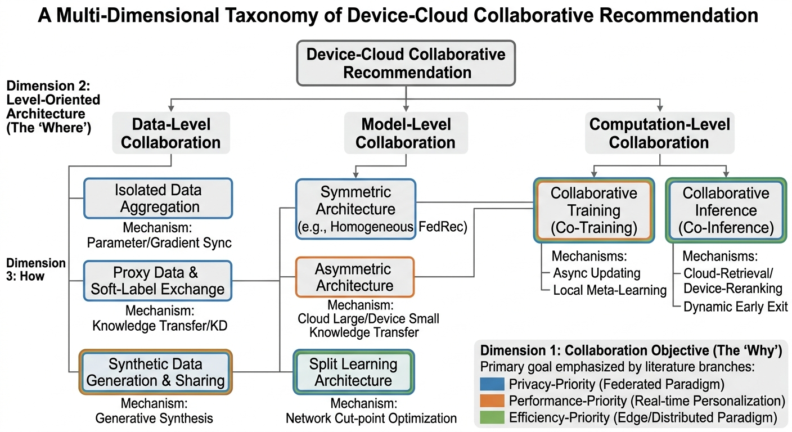
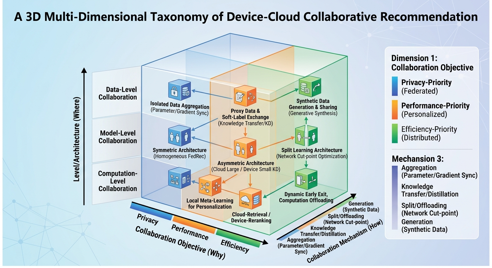
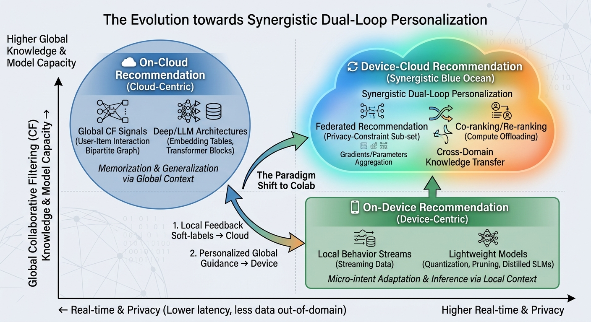
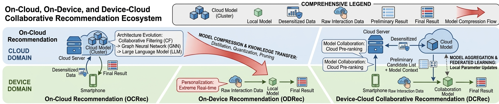

# Device-Cloud Personalization and Collaboration in Recommendation: A Survey

### Part 1: 多维度分类法设计 (The Proposed Taxonomy)

* **(Why) Dimension 1: Objective-Oriented Paradigm (目标导向范式)**
  * *Privacy-Priority (Federated Recommendation, 联邦范式)*：传统联邦推荐本质上属于端云协同的一个子集，其核心目标是数据不出域，强调多方安全计算、本地差分隐私。
  * *Performance-Priority (Classic Device-Cloud Collaborative Rec, 经典端云范式)*：追求极致实时性能，云侧维护泛化大模型，端侧维护千人千面的实时轻量模型。
  * *Efficiency-Priority (Distributed/Edge-Assisted Rec, 分布式/边缘范式)*：跨WAN的广义分布式协同，强调将设备作为海量异构Worker，以极低的成本分担云端算力压力,追求极致的资源利用率，通过计算卸载、通信压缩解决算力瓶颈。
* **(Where) Dimension 2: Level-Oriented Architecture (层次导向架构) —— [本文的核心章节划分依据]**
  * *Data Collaboration (数据层)*：虚拟数据合成、基于差分隐私的软标签（Soft-labels）交互、User-Item局部交互图传输，解决“信息孤岛”与隐私的矛盾。
  * *Model Collaboration (模型层)*：云到端的知识蒸馏（KD）、端到云的实时个性化特征（Real-time Feedback）上报，解决端云异构算力与模型容量的矛盾。
  * *Computation Collaboration (计算层)*：训练态的Co-training（如异步/同步梯度调度）、推理态的Co-inference（如云端粗排+端侧精排/重排），解决训练/推理负载的全局最优分配问题。
* **(How) Dimension 3: Mechanism-Oriented Topology (机制导向拓扑)**
  * *Symmetric (Aggregation-based, 同构聚合型)*：云端与端侧拥有相同的网络骨架（如传统横向联邦推荐），同构模型参数/梯度的自下而上汇聚（如FedAvg）。
  * *Asymmetric (Distillation-based, 异构蒸馏/迁移型)*：云端大网络（大Embedding/大LLM）+ 端侧小网络（轻量级双塔/SLM/实时重排模块），异构模型之间的知识自上而下或双向传递（如KD, Soft-labels）。
  * *Split/Offloading-based (切分/卸载型)*：深度计算图的物理截断与接力（如Split Learning, 边缘重排）。
* **协同发生在推荐流水线的哪个环节**
  * **Candidate Collaboration（候选协同）**：云端基于全局物品库做召回/候选生成，端侧在有限候选上做轻量个性化处理。典型叙述在两阶段系统或端云协同框架里很常见。
  * **Ranking and Reranking Collaboration（排序协同）**：云端负责强模型排序/语义建模，端侧负责实时序列重排/融合，或由控制器动态决定“用云还是用端”。
  * **Update Collaboration（更新协同）**：围绕模型更新与个性化模块更新形成的端云闭环（云→端下发适配；端→云上传知识/反馈；或双向蒸馏/参数生成）。
* **个性化载体在端云之间如何分工**
  * **Parameter-level Personalization（参数级个性化）**：端侧保留或生成用户/设备特定参数（patch、adapter、结构/量化策略），云侧协调生成或蒸馏。例子包括DCCL的MetaPatch与云侧蒸馏回收，DUET/Forward-OFA/CHORD这类“云侧生成、端侧免反传快速适配”的方向。
  * **Representation-level Personalization（表示级个性化）**：云侧提供更“语义化/长期”的用户表示，端侧用最新交互校准、融合或判断何时需要刷新；例如SCaLRec专门讨论云侧语义向量缓存带来的“语义陈旧”并在端侧校准。
  * **Decision-level Personalization（决策级个性化）**：把“是否请求云端、如何组合云端与端侧结果”变成可学习决策（控制器/智能请求/策略规划）。Meta Controller与LSC4Rec的“intelligent request”都属于此类。
* **端云交换的“协同信号”是什么**
  * **梯度/参数聚合**（典型联邦学习/对称聚合）：FedAvg是代表性范式之一，强调在非IID与通信受限下聚合端侧更新。
  * **软标签/候选集/排序分数**（蒸馏与协同推理）：例如LSC4Rec让云端LLM生成候选与初排，端侧小模型重排，并通过一致性判断决定是否请求新候选。
  * **语义用户表示/结构化画像**（语义协同）：例如SCaLRec与CDA4Rec都把语义建模与实时重排拆给云与端，并显式讨论协调与计划/校准。
  * **计算图切分/卸载**（split/offloading）：这在推荐中通常需要结合Embedding与隐私/带宽做额外讨论，通用Split Learning给出切分训练的基本形态。

---

### Part 2: 详细论文大纲 (Detailed Paper Outline)

将核心部分按 **Level-Oriented (Data -> Model -> Computation)** 进行组织，这样符合机器学习Pipeline的自然逻辑，极具条理性。

#### **Title:** Device-Cloud Personalization and Collaboration in Recommendation: A Survey

**Abstract**

* (要点) 概述推荐系统的发展瓶颈；定义端云协同推荐的广义范式；介绍本文提出的多维度分类法；总结在LLM时代的未来挑战。

**1. Introduction**

* **1.0 推荐系统概述**：
  * 推荐系统用于在信息爆炸下提供个性化内容与服务。
  现实工业系统多采用多阶段级联（retrieval/recall→预排/粗排→精排→重排→端侧/边缘重排等）架构，以在巨量物品库上控制延迟与算力成本，同时追求高质量排序。
  传统集中式云端推荐（On-Cloud）长期主导，但它在“秒级兴趣捕捉、隐私与成本”上逐渐暴露瓶颈；端侧推荐（On-Device）带来零/低延迟与隐私优势，却面临“协同信号不足、模型/Embedding受限、候选集受限”等推荐特有挑战；于是端云协同推荐（Device-Cloud）成为兼顾全局知识与本地实时个性化的关键范式。联邦推荐是端云协同推荐在“隐私优先目标”下的一类典型实现，共享了“端侧参与训练/更新、云端聚合”的组织结构。
  * **数据异质性既是副作用，又是推荐个性化的来源。** 推荐系统里，“每个用户就是一个分布”，而且分布随时间、场景、曝光策略改变；在联邦/端侧情境中，这种**不均衡与非IID**是常态且会直接影响训练、更新与个性化策略。
    * 在On-Cloud范式里，异质性往往通过“大规模数据 + 高容量模型 + 全局参数共享”被“平均化”；个性化主要体现在用户Embedding/序列编码上。
    * 在On-Device与Device-Cloud范式里，异质性被放大（不同设备、不同用户、不同上下文、不同网络条件），因此需要更显式的个性化结构（例如：可插拔的个性化模块、设备特定结构/参数生成、端侧在线适配）。
  * **以Embedding表为中心的模型结构是推荐系统的“系统瓶颈源”** 。推荐模型与通用视觉/语言模型一个很本质的差异在于：**需要处理高基数稀疏特征（用户ID、物品ID、类别ID等），因此Embedding查表与Embedding表存储成为核心部件**。在端云协同场景中，决定了端侧能否存下“足够覆盖的物品表示/用户表示”；云侧是否需要托管大规模Embedding并向端侧下发“可缓存/可裁剪/可生成”的子结构；协同通信的主要负担是否来自Embedding相关参数/索引/候选集。
  * **海量用户设备规模使“协同机制设计”成为第一优先级** 。工业推荐常服务十亿级用户规模，系统设计必须面对“海量请求 + 多阶段流水线”。例如在大规模视频/应用推荐中，服务规模与流水线拆分是常见架构描述。端云协同推荐进一步把“设备规模”推到台前：设备不仅是数据源和展示端，更可能成为训练/更新/重排的执行节点。以DCCL为例，作者明确将其设定为端云协同学习框架，并讨论“千人千模”以及云侧吸收海量端侧个性化模型知识的机制。**端云协同推荐不是“把模型搬到端上”这么简单，而是要在参与规模巨大、异质性强、通信受限的前提下，把个性化机制变成可扩展的协同协议**。

* **1.1 Evolution and Bottlenecks of On-Cloud Recommendation**
  <!-- * **要点**：回顾云端推荐的演进（从CF、GNN到百亿参数的LLM架构），强调其优势在于拥有全局知识结构与极强的表达能力。然后笔锋一转，指出其面临的“三座大山”：网络延迟高导致无法捕捉秒级短期兴趣、集中式存储带来的隐私泄露风险、以及高昂的推理成本。 -->
  * **分类**：
    * Shallow Collaborative Filtering Architectures
    * Deep Representation Learning Architectures
    * Large Semantic Alignment Architectures
  * **优势**：
    * 云端能接触到更完整的历史交互与全局物品库，因此适合承担**大规模候选生成/召回**与强表达力排序模型；工业经典描述往往把系统拆成候选生成与排序两阶段。
    * 云端更容易训练与部署 Embedding 密集型的大模型（例如DLRM范式），以覆盖高基数稀疏特征并获得更强的协同泛化能力。
  * **劣势**：
    * **“兴趣漂移与反馈时效”**：云端模型往往依赖日志回流与异步更新，对秒级/会话级兴趣变化反应慢；因此工业系统常把更贴近实时行为的阶段放在后面（如重排/端侧重排）。
    * **“对海量候选的推理成本”**：在推荐流水线里，越靠前的阶段越需要在海量候选中筛选，越靠后的阶段模型越重；尤其当引入LLM作为排序器时，LLM更适合放在候选较小的排序/重排环节，否则成本难以承受。
    * **“集中式数据/模型风险”**：集中式CloudRS会面临资源消耗、延迟与隐私/安全风险，推动DeviceRS兴起。
  * **个性化**：长期偏好由云端全局模型吸收长期历史与跨用户协同信号，中期偏好由序列模型对更长窗口行为建模，难以低延迟捕捉短期偏好。**Global Macro-Personalization (宏观个性化)**。云侧拥有“上帝视角”（Global CF Signals），能发现全局用户的协同信息，打破信息茧房（Serendipity），捕捉用户的长周期兴趣。
  * **过渡**：云端集中式个性化在实时性与隐私上仍面临不可忽视的瓶颈，这推动了端侧推荐与端云协同推荐的兴起。
* **1.2 The Rise and Limitations of On-Device Recommendation**
  <!-- * **要点**：总结设备端推荐（On-device Rec）的核心技术栈，如模型量化、蒸馏、剪枝等压缩技术，强调其在隐私保护和零延迟（Zero-latency）上的优势。接着指出其致命瓶颈：端侧算力与存储受限（无法容纳千万级Item ID）、存在“信息孤岛”（无法获知其他用户的协同过滤信号）。 -->
  * **分类**：
    * **Deployable Inference on Devices（可部署推理）**：核心回答“Embedding与模型如何装进设备、如何低功耗推理”。
    * **On-Device Training and Personalization（端侧训练与个性化）**：核心回答“如何用本地数据实现会话级/个体级更新、如何处理漂移”。
  * **优势**：
    * 端侧更靠近**实时交互与上下文信号**，因此常承担“候选列表的端上重排/重排序”，以减少对云端往返延迟并更快响应兴趣变化；EdgeRec直接把动机写成“云到端瀑布式”架构在带宽与时延上影响反馈与体验，提出在端侧做实时计算以更精准捕捉偏好。端侧推荐通常对云端候选做基于实时行为序列的重排，因此端侧模型往往偏“时序/序列推荐”。
    * **隐私保护**通过数据本地化实现了本质安全，用户行为无需离开设备即可参与建模
    * **低云端成本**将推理负载从中心化基础设施转移到边缘设备，显著降低了企业的运营成本。
  * **劣势**：
    * **候选空间受限**：端侧很难维护全量物品库与大Embedding，现实中常依赖云端召回后缓存候选；当用户兴趣突然变化时，“端侧被缓存候选限制”会成为明显瓶颈，这也是Meta Controller类工作要解决的关键痛点之一。
    * **协同过滤信号不足**：端侧本地数据天然缺少跨用户的协同信息（其他用户与物品的交互），因此纯端侧很难复现云端CF/大规模Embedding的优势；端侧只能看到用户自己的历史，完全失去了用户-物品全局交互图（User-Item Bipartite Graph），极易导致推荐结果严重同质化，陷入局部极小值。这推动了端云协同或联邦式聚合思想的引入。
    * **端侧算力与存储严格受限，无法承载大规模嵌入表**。推荐系统的嵌入表中心架构与端侧资源约束存在结构性冲突。一个工业级推荐系统的嵌入表可能达到数百GB，远超任何移动设备的存储容量。即使通过激进的压缩技术，也难以在保持精度的同时满足端侧部署需求。这导致端侧推荐模型通常只能采用极简的架构，牺牲了大量的建模能力。
    * **本地数据稀疏导致的冷启动与过拟合**。单个用户的行为数据相对于全局数据极为稀疏，基于稀疏数据的本地训练容易导致严重的过拟合。测试时训练机制虽然能够实现快速适应，但也加剧了这一问题——模型可能过度拟合近期的噪声模式，产生不稳定和低质量的推荐。
    * **模型更新滞后于全局趋势**。端侧模型一旦部署，其参数更新主要依赖本地适应，难以快速感知全局的趋势变化和新物品的涌现。这对于新闻推荐、热点内容分发等时效性要求高的场景尤为不利。
  * **个性化**：**端侧个性化更偏向对短期兴趣、实时上下文与隐私敏感信号的建模**，而不是“学到更大的泛化模型”。这与后文端云协同的“分工协作式个性化”自然衔接。 **Local Micro-Personalization (微观个性化 / 极度个性化)**。模型可以接触到云端无法获取的超细粒度隐私特征（如屏幕滑动速度、停留时长、本地传感器数据），实现真正的“千人千面”和“零延迟响应”。
  * **过渡**：端侧推荐在‘短期个性化与隐私’上具备天然优势，但其缺失的全局协同信号与候选空间限制，决定了它更需要与云端进行结构化协作。
* **1.3 The Paradigm Shift: Device-Cloud Collaboration**
  <!-- * **要点**：正式提出“端云协同推荐（Device-Cloud Recommendation）”这一终极范式。强调该范式的核心在于**Co-training & Co-inference**，完美中和了云与端的优缺点。 -->
  * **定义**：在推荐任务中，**端侧与云侧共同参与**推荐流水线的推理/训练/更新，并通过显式协同机制交换信息（如候选集、软标签、表示、参数、梯度或策略），以在**全局协同信号**与**本地实时个性化**之间达成折中。

    | 纳入标准                               | 排除标准                                          |
    | :------------------------------------- | :------------------------------------------------ |
    | 存在云-端双向信息流动                  | 纯云中心推荐（端侧仅作为数据收集界面）            |
    | 云端和端侧在推荐流程中承担互补角色     | 纯端侧推荐（无云侧持续协同）                      |
    | 端侧参与最终的推荐推理或排序决策       | 单向知识迁移（如云端预训练+端侧微调，无反馈回路） |
    | 协同机制对精度、延迟或隐私有可量化贡献 | 传统模型压缩与部署（无运行时云-端交互）           |

    * 在组织结构上，联邦学习强调“数据留在端侧、云端聚合更新”，其动机与约束与端云协同高度相似。在目标上，联邦推荐通常是**隐私优先**的端云协同推荐实现，但端云协同推荐还可以覆盖“性能/实时性优先、成本/资源优先”等更一般的协同目标。
    > 可以提出这样一个公式或概念：$\\ \text{Device-Cloud Rec} = \text{Distributed Rec Architecture} + \text{Configurable Privacy/Latency Constraints}\\$ 即，FedRec 是在极高 Privacy Constraint 下的 Device-Cloud Rec 实例。

* **分类**：

* **个性化** ：**Synergistic Dual-Loop Personalization (协同双循环个性化)**。云端慢循环（Slow-loop）提供全局协同知识与泛化能力，端侧快循环（Fast-loop）提供实时响应与隐私保护，实现了**个性化-泛化权衡的动态可调**。

  >* **个性化强度的形式化刻画**。设端侧模型的自适应深度为$d_{local}$（如本地微调的步数、测试时训练的强度），云端干预的频率为$f_{cloud}$（如全局模型更新的周期、云端校正触发的阈值），则系统的整体个性化强度可以表征为$P = f(d_{local}, f_{cloud}^{-1})$——本地自适应越深、云端干预越稀疏，个性化强度越高。端云协同架构允许根据应用场景动态调整这一权衡：对于兴趣稳定的场景（如书籍推荐），可以降低$d_{local}$、提高$f_{cloud}$，依赖云端的全局知识；对于兴趣快速变化的场景（如短视频推荐），则提高$d_{local}$、降低$f_{cloud}$，强化端侧的实时适应能力。
  >* **用户画像的层次化构建**是端云协同个性化的核心机制。我们将用户画像解构为三个层次：**云端长期兴趣**——基于用户完整历史行为构建的稳定偏好，更新周期较长（小时-天级），反映用户的深层兴趣结构和人口统计特征；**端侧短期意图**——基于当前会话行为的动态偏好，实时更新（秒-分钟级），反映用户的即时需求和上下文敏感的兴趣；**实时上下文信号**——设备传感器提供的当前状态（位置、时间、活动模式等），用于触发场景化的推荐策略。这三个层次通过协同机制有机整合：云端长期兴趣为端侧模型提供初始化先验，端侧实时行为通过特征上报或模型更新反馈影响云端的全局知识，形成双向增强的闭环。
  >* **协同机制对个性化的增强效应**体现在两个维度：一是**跨设备知识迁移**，云端聚合的相似用户信号可以间接传递到端侧，缓解端侧孤立的协同过滤失效问题；二是**相似用户信号引入**，通过云端的聚类或图分析，将"与你相似的用户"的偏好模式以隐私保护的形式（如聚合统计、合成样本、蒸馏信号）注入端侧模型，增强冷启动和稀疏场景下的推荐质量。

* **LLM 时代的端云协同推荐**
  * **云端LLM + 端侧SLM的协同架构**。LSC4Rec（2025）和CDA4Rec（2025）探索了这一架构的可行性：云端部署具备强大语义理解和推理能力的LLM（如LLaMA-8B），负责复杂的用户意图解析、候选物品的深度理解、以及多步推理规划；端侧部署轻量化的SLM（如LLaMA-1B或更小的专用模型），负责实时响应高频请求、处理隐私敏感的特征、以及执行云端下发的推荐策略。两者的协同通过智能请求策略实现——端侧SLM首先尝试独立处理请求，当检测到不确定性高或需要深度推理时，动态调用云端LLM，形成"端侧为主、云端增强"的高效协作模式。
  * **智能体驱动的动态任务分解**。CDA4Rec框架展示了多智能体协作在推荐任务中的潜力，这一思想可以扩展到云-端场景：云端智能体负责全局策略规划、跨用户知识整合、复杂推理任务；端侧智能体负责实时感知、本地决策执行、用户交互管理。两者的协作通过标准化的通信协议和任务接口实现，支持灵活的动态任务分解和负载均衡。
  * **语义校准与知识对齐**。SCaLRec（2026）提出了语义校准框架，解决云端LLM与端侧推荐模型之间的语义空间不一致问题。通过建立统一的语义表示空间和跨模态对齐机制，实现大模型的通用知识与推荐任务的领域知识、云端的抽象语义与端侧的具体行为模式之间的有效融合。

**2. Preliminaries and Taxonomy**

* **2.1 Problem Formulation**
  * *写作要点*：使用严谨的数学符号，统一表示端侧数据集、云端数据集、端侧模型($f_\theta$)、云端模型($F_\Phi$)及其优化目标。
* **2.2 The Proposed Taxonomy**
  * *写作要点*：引出前文设计的“目标-层次-机制”三维分类法，并配以Overview插图，为下文章节奠定基调。

**3. Data-Level Collaboration: Bridging Silos and Privacy**

* *段落总起*：本节主要探讨端云之间如何进行“数据/信息”层面的协同，核心矛盾是在不侵犯隐私的前提下实现全局协同。
* **3.1 Isolated Data Aggregation (联邦数据隔离协同)**
  * *写作要点*：回顾隐私优先的联邦推荐（FedRec），数据绝对物理隔离，仅交换中间梯度/参数。探讨Non-IID数据导致的客户端漂移（Client Drift）问题及解决策略。
* **3.2 Proxy Data and Soft-Label Communication (代理数据与软标签传输)**
  * *写作要点*：介绍性能优先的协同方式，如云端将全局特征转化为Soft-labels或Knowledge Embeddings下发到端侧（如KD机制），避免直接传输生数据。
* **3.3 Synthetic Data and Generative Sharing (合成数据与生成式共享)**
  * *写作要点*：探讨前沿的效率优先协同，利用生成模型（如GAN/Diffusion）在端侧生成脱敏的User-Profile或在云端生成Synthetic Item，进行端云交换以扩充样本空间。

**4. Model-Level Collaboration: Managing Heterogeneity and Capacity**

* *段落总起*：本节探讨面对端云几百倍的算力差异，如何设计协同的模型架构。
* **4.1 Symmetric Architecture (同构模型协同)**
  * *写作要点*：经典的联邦学习架构，端云维护结构完全相同的模型。重点分析其在算力受限设备上的缩放难题。
* **4.2 Asymmetric Architecture (异构模型协同/云大端小)**
  * *写作要点*：目前工业界最主流的架构（Performance-Priority）。云端部署大模型（百亿参数，负责泛化和召回），端侧部署个性化小模型（百万参数，负责实时重排/特征交互）。
* **4.3 Split Architecture (切分模型协同)**
  * *写作要点*：效率优先的Split Learning机制。将深层网络在某一层切断（Cut layer），底部在端侧运行提取特征，顶部在云端运行完成预测，重点综述切分点的动态优化策略。

**5. Computation-Level Collaboration: Co-Training and Co-Inference**

* *段落总起*：本节深入到计算负载的分配，探讨如何协同训练参数与协同推理推荐结果。
* **5.1 Collaborative Training Workloads (协同训练)**
  * *5.1.1 Synchronous vs. Asynchronous Parameter Updating*: 综述在不可靠网络下，端云梯度的异步更新机制与分布式参数服务器（Distributed PS）的实现。
  * *5.1.2 Meta-Learning for On-Device Personalization*: 云端学习Meta-knowledge，端侧利用几步本地Gradient Descent实现极其快速的个性化适应（如MAML在端云的变体）。
* **5.2 Collaborative Inference Workloads (协同推理)**
  * *5.2.1 Cloud-Retrieval & Device-Reranking (云端预排+端侧重排)*: 分析工业界标准的推理Pipeline，云端下发Top-K候选集，端侧结合设备实时Context（电量、滑动速度、最新点击）进行最终排序。
  * *5.2.2 Dynamic Early Exit (动态提前退出)*: 算力卸载策略。端侧先用轻量级模型评估，如果置信度极高则直接输出推荐结果；若遇到长尾/复杂请求，则fallback到云端大模型推理，节省网络带宽。

**6. System Evaluation, Simulation Platforms, and Datasets**

* *写作要点*：由于端云协同难以在真实环境复现，本节整理目前主流的仿真框架（如FedScale, Flower, EdgeRec等）和适合进行端云协同测试的Public Datasets（带有时间戳和设备属性的数据）。

**7. Future Directions (重点见下文 Part 3)**

* *写作要点*：展望大模型时代和异构硬件时代的新机遇。

**8. Conclusion**

---

### Part 3: Future Directions Highlights (大模型时代的端云协同前瞻)

在LLM（大语言模型/Foundation Models）席卷推荐领域的当下，端云协同的范式正在发生本质的改变（从单纯的参数同步转向语义和知识的协同）。

**1. Collaborative Inference in Rec-LLMs (大模型推荐的端云联合推理与投机解码)**

* **核心痛点**：基于生成式的推荐大模型（如基于LLaMA构建的推荐模型）推理延迟极高，无法满足工业界几十毫秒的要求。
* **未来方向**：将投机解码（Speculative Decoding）引入端云协同。端侧部署极小的语言模型（SLM, 如0.5B）作为Draft Model，快速生成推荐Item序列；云端的巨型LLM（如100B）作为Target Model进行批处理验证。同时，研究KV Cache的端云卸载与共享，打破自回归生成的延迟瓶颈。

**2. Parameter-Efficient Federated Fine-Tuning (面向推荐的端云参数高效联邦微调)**

* **核心痛点**：无法在端侧设备对几十亿参数的模型进行Full Fine-Tuning。
* **未来方向**：采用端云PEFT（Parameter-Efficient Fine-Tuning）架构。云端冻结巨大的Foundation Model，向端侧下发轻量级的LoRA/Adapter模块。端侧仅利用本地User Behavior微调几兆大小的Adapter。云端定期聚合这些个性化Adapter进行全局知识的融合与聚类（Federated LoRA）。

**3. Agentic Collaboration: Multi-Agent Cloud-Device Recommender (基于多智能体的端云协同推荐)**

* **核心痛点**：传统的端云协同过度依赖张量（Tensor）和梯度（Gradient）的传输，缺乏可解释性，且受限于严格的模型结构。
* **未来方向**：端云不再传递梯度，而是交互**自然语言或System Prompts**。云端充当“Global Orchestrator Agent”，掌握全域物品图谱；端侧充当用户的“Personal Assistant Agent”，完全掌握用户的隐私偏好。两者通过对话（Conversation）/隐式Prompt压缩的方式协商推荐列表，实现完全解耦的语义级协同。

**4. Synchronized On-Device RAG (端侧增强与云端RAG的动态同步)**

* **核心痛点**：大模型容易产生幻觉（Hallucination），而纯云端的RAG（检索增强生成）需要检索千万级Item Vector库，消耗巨大计算量且无法兼顾用户本地最新状态。
* **未来方向**：实现端云RAG的分布式缓存。云端维护全量物品的向量数据库（Vector DB）；端侧基于用户近期画像，本地预加载一个微型的个性化子索引（Sub-Index）。推理时，优先在本地进行轻量级RAG检索作为大模型的上下文，仅在Cache Miss时向云端发起检索，大幅降低云端向量数据库的QPS压力。
