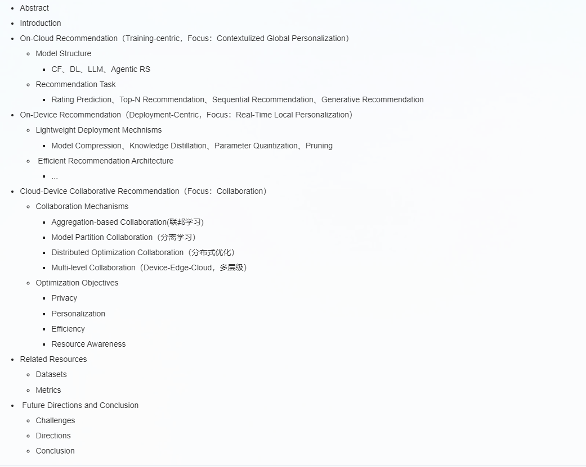

# DCRec
Device-Cloud Personalization and Collaboration in Recommendation: A Survey

## Surveys

### Device-Cloud Collaboration for Artificial Intelligence

- Edge-Cloud Polarization and Collaboration: A Comprehensive Survey for AI, IEEE TKDE, 2023. [[PDF]](https://dl.acm.org/doi/abs/10.1109/TKDE.2022.3178211).
- End-Edge-Cloud Collaborative Computing for Deep Learning: A Comprehensive Survey, IEEE CST, 2024. [[PDF]](https://ieeexplore.ieee.org/abstract/document/10508191).
- Edge-Cloud Collaborative Computing on Distributed Intelligence and Model Optimization: A Survey, IEEE CST, 2026. [[PDF]](https://ieeexplore.ieee.org/abstract/document/11417814).
- Collaborative Learning of On-Device Small Model and Cloud-Based Large Model: Advances and Future Directions, Arxiv, 2025. [[PDF]](https://arxiv.org/abs/2504.15300).
- A Survey on Collaborative Mechanisms Between Large and Small Language Models, Arxiv, 2025. [[PDF]](https://arxiv.org/abs/2505.07460).

### Device-Cloud Personalization for Recommendation

- Distributed Recommendation Systems: Survey and Research Directions, ACM TOIS, 2024. [[PDF]](https://dl.acm.org/doi/epdf/10.1145/3694783).
- On-Device Recommender Systems: A Comprehensive Survey, DSE, 2025. [[PDF]](https://link.springer.com/article/10.1007/s41019-025-00308-8).
- Personalized Recommendation Models in Federated Settings: A Survey, IEEE TKDE, 2025. [[PDF]](https://ieeexplore.ieee.org/abstract/document/11151823).
- A Scenario-Oriented Survey of Federated Recommender Systems: Techniques, Challenges, and Future Directions, Arxiv, 2025. [[PDF]](https://arxiv.org/abs/2508.19620), [[CODE]](https://github.com/SmilesLab-XJTU/Survey-FedRec).

## On-Cloud Recommendation

### Classic Collaborative Filtering

- GroupLens: An Open Architecture for Collaborative Filtering of Netnews, ACM CSCW, 1994. [[PDF]](https://dl.acm.org/doi/10.1145/192844.192905).
- Item-based Collaborative Filtering Recommendation Algorithms, WWW, 2001. [[PDF]](https://dl.acm.org/doi/10.1145/371920.372071).
- Matrix Factorization Techniques for Recommender Systems, IEEE Computer, 2009. [[PDF]](https://ieeexplore.ieee.org/document/5197422).
- BPR: Bayesian Personalized Ranking from Implicit Feedback, UAI, 2009. [[PDF]](https://arxiv.org/abs/1205.2618).

### Deep Learning for Recommendation

- Wide & Deep Learning for Recommender Systems, RecSys DLRS, 2016. [[PDF]](https://arxiv.org/abs/1606.07792).
- Neural Collaborative Filtering, WWW, 2017. [[PDF]](https://arxiv.org/abs/1708.05031).
- DeepFM: A Factorization-Machine based Neural Network for CTR Prediction, IJCAI, 2017. [[PDF]](https://arxiv.org/abs/1703.04247).
- Deep Interest Network for Click-Through Rate Prediction, KDD, 2018. [[PDF]](https://arxiv.org/abs/1706.06978).
- BERT4Rec: Sequential Recommendation with Bidirectional Encoder Representations from Transformer, CIKM, 2019. [[PDF]](https://arxiv.org/abs/1904.06690).

### Large Models for Recommendation

- Large Language Models are Zero-Shot Rankers for Recommender Systems, Arxiv, 2023. [[PDF]](https://arxiv.org/abs/2305.08845).
- LLMRec: Large Language Models with Graph Augmentation for Recommendation, WSDM, 2024. [[PDF]](https://arxiv.org/abs/2311.00423).
- P5: Are Large Language Models Better Recommenders?, RecSys, 2022. [[PDF]](https://arxiv.org/abs/2203.13366).
- LLMRec: Benchmarking Large Language Models on Recommendation Task, Arxiv, 2023. [[PDF]](https://arxiv.org/abs/2308.12241).

### Agentic Recommendation

- RecMind: Large Language Model Powered Agent For Recommendation, NAACL Findings, 2024. [[PDF]](https://aclanthology.org/2024.findings-naacl.271.pdf).
- Recommender AI Agent: Integrating Large Language Models for Interactive Recommendations, Arxiv, 2023. [[PDF]](https://arxiv.org/abs/2308.16505).
- A Survey of Large Language Model Empowered Agents for Recommendation and Search, Arxiv, 2025. [[PDF]](https://arxiv.org/abs/2503.05659).

## On-Device Recommendation

## Device-Cloud Recommendation

