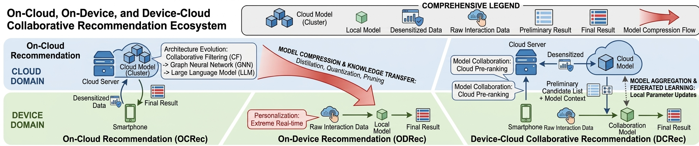

# DCRec: Device-Cloud Personalization and Collaboration in Recommendation: A Survey

**Abstract** (Draft): Recommender systems are undergoing a paradigm shift from purely on-cloud intelligence to device-cloud collaborative intelligence. Traditional on-cloud recommendation has evolved from shallow collaborative filtering and deep embedding models to large language model-driven frameworks, benefiting from strong contextual personalization and world knowledge. However, such schemes increasingly face three major challenges: high latency that limits responsiveness to real-time user preferences, privacy risks arising from centralized data storage, and the growing computational cost of large-scale inference. In parallel, on-device recommendation has emerged as a promising solution for low-latency and real-time personalization through efficient adaptation techniques such as quantization, pruning, and knowledge distillation. Nevertheless, its effectiveness is constrained by limited computation and storage resources, the difficulty of accommodating massive item spaces, and the lack of cross-user collaborative signals. These complementary strengths and limitations have given rise to device-cloud recommendation (DCRec), a new paradigm that integrates cloud-side contextual personalization with device-side real-time personalization through collaborative training and inference. In this survey, we present a novel taxonomy of this emerging field from the dual perspectives of personalization and collaboration, with particular emphasis on three distinctive challenges: natural data heterogeneity, recommendation-specific embedding-centric model structures, and the massive scale of distributed user devices. We further summarize representative methods, evaluation settings, and open research directions, with the aim of providing a structured foundation for the development of next-generation recommender systems in terms of adaptability, privacy preservation, and efficiency.

## 📖Related Surveys

### Device-Cloud Collaboration for Artificial Intelligence

- Edge-Cloud Polarization and Collaboration: A Comprehensive Survey for AI, IEEE TKDE, 2023. [[PDF]](https://dl.acm.org/doi/abs/10.1109/TKDE.2022.3178211).
- End-Edge-Cloud Collaborative Computing for Deep Learning: A Comprehensive Survey, IEEE CST, 2024. [[PDF]](https://ieeexplore.ieee.org/abstract/document/10508191).
- Edge-Cloud Collaborative Computing on Distributed Intelligence and Model Optimization: A Survey, IEEE CST, 2026. [[PDF]](https://ieeexplore.ieee.org/abstract/document/11417814).
- Collaborative Learning of On-Device Small Model and Cloud-Based Large Model: Advances and Future Directions, Arxiv, 2025. [[PDF]](https://arxiv.org/abs/2504.15300).
- A Survey on Collaborative Mechanisms Between Large and Small Language Models, Arxiv, 2025. [[PDF]](https://arxiv.org/abs/2505.07460).

### Device-Cloud Personalization for Recommendation

- Distributed Recommendation Systems: Survey and Research Directions, ACM TOIS, 2024. [[PDF]](https://dl.acm.org/doi/epdf/10.1145/3694783).
- On-Device Recommender Systems: A Comprehensive Survey, DSE, 2025. [[PDF]](https://link.springer.com/article/10.1007/s41019-025-00308-8).
- A Survey on Federated Recommendation Systems, IEEE TNNLS, 2024. [[PDF]](https://link.springer.com/article/10.1007/s41019-025-00308-8).
- A Scenario-Oriented Survey of Federated Recommender Systems: Techniques, Challenges, and Future Directions, Arxiv, 2025. [[PDF]](https://arxiv.org/abs/2508.19620).
- Distributed Learning for Next-Gen Recommender Systems: A Survey, IPCID, 2025. [[PDF]](https://link.springer.com/chapter/10.1007/978-3-032-12481-4_7).
- Personalized Recommendation Models in Federated Settings: A Survey, IEEE TKDE, 2025. [[PDF]](https://ieeexplore.ieee.org/abstract/document/10423793/).

## 🗄️On-Cloud Recommendation

### Shallow Collaborative Filtering Models

- GroupLens: An Open Architecture for Collaborative Filtering of Netnews, ACM CSCW, 1994. [[PDF]](https://dl.acm.org/doi/10.1145/192844.192905), [[CODE]](https://github.com/hongleizhang/RSAlgorithms).
- Item-based Collaborative Filtering Recommendation Algorithms, WWW, 2001. [[PDF]](https://dl.acm.org/doi/10.1145/371920.372071), [[CODE]](https://github.com/hongleizhang/RSAlgorithms).
- Probabilistic Matrix Factorization, NIPS, 2007. [[PDF]](https://proceedings.neurips.cc/paper_files/paper/2007/file/d7322ed717dedf1eb4e6e52a37ea7bcd-Paper.pdf), [[CODE]](https://github.com/hongleizhang/RSAlgorithms).
- Collaborative Filtering for Implicit Feedback Datasets, ICDM, 2008. [[PDF]](http://ieeexplore.ieee.org/document/4781121/), [[CODE]](https://github.com/benfred/implicit).
- Factorization Meets the Neighborhood: A Multifaceted Collaborative Filtering Model, KDD, 2008. [[PDF]](https://people.engr.tamu.edu/huangrh/Spring16/papers_course/matrix_factorization.pdf), [[CODE]](https://github.com/hongleizhang/RSAlgorithms).
- Matrix Factorization Techniques for Recommender Systems, IEEE Computer, 2009. [[PDF]](https://ieeexplore.ieee.org/document/5197422), [[CODE]](https://github.com/hongleizhang/RSAlgorithms).
- BPR: Bayesian Personalized Ranking from Implicit Feedback, UAI, 2009. [[PDF]](https://arxiv.org/abs/1205.2618), [[CODE]](https://github.com/gamboviol/bpr).
- Factor in the neighbors: Scalable and accurate collaborative filtering, ACM TKDD, 2010. [[PDF]](https://dl.acm.org/doi/abs/10.1145/1644873.1644874), [[CODE]](https://github.com/hongleizhang/RSAlgorithms).
- Factorization Machines, ICDM, 2010. [[PDF]](https://analyticsconsultores.com.mx/wp-content/uploads/2019/03/Factorization-Machines-Steffen-Rendle-Osaka-University-2010.pdf), [[CODE]](https://github.com/coreylynch/pyFM).

### Deep Representation Learning Models

- Deep Neural Networks for YouTube Recommendations, RecSys, 2016. [[PDF]](https://dl.acm.org/doi/10.1145/2959100.2959190).
- Wide & Deep Learning for Recommender Systems, RecSys DLRS, 2016. [[PDF]](https://arxiv.org/abs/1606.07792).
- Neural Collaborative Filtering, WWW, 2017. [[PDF]](https://arxiv.org/abs/1708.05031).
- DeepFM: A Factorization-Machine based Neural Network for CTR Prediction, IJCAI, 2017. [[PDF]](https://arxiv.org/abs/1703.04247).
- Deep Interest Network for Click-Through Rate Prediction, KDD, 2018. [[PDF]](https://arxiv.org/abs/1706.06978).
- SASRec: Self-attentive Sequential Recommendation, ICDM, 2018. [[PDF]](https://peerj.com/articles/cs-1701.pdf).
- Session-Based Recommendation with Graph Neural Networks, AAAI, 2019. [[PDF]](https://ojs.aaai.org/index.php/AAAI/article/view/3804).
- BERT4Rec: Sequential Recommendation with Bidirectional Encoder Representations from Transformer, CIKM, 2019. [[PDF]](https://arxiv.org/abs/1904.06690).
- LightGCN: Simplifying and Powering Graph Convolution Network for Recommendation, SIGIR, 2020. [[PDF]](https://dl.acm.org/doi/10.1145/3397271.3401063).

### Large Semantic Alignment Models

- Recommendation as Language Processing: A Unified Pretrain, Personalized Prompt & Predict Paradigm, RecSys, 2022. [[PDF]](https://dl.acm.org/doi/10.1145/3523227.3546767).
- Recommender Systems with Generative Retrieval, NeurIPS, 2023. [[PDF]](http://arxiv.org/abs/2305.05065).
- Diffusion Recommender Model, SIGIR, 2023. [[PDF]](https://dl.acm.org/doi/10.1145/3539618.3591663).
- TALLRec: An Effective and Efficient Tuning Framework to Align Large Language Model with Recommendation, RecSys, 2023. [[PDF]](http://arxiv.org/abs/2305.00447).
- Large Language Models are Zero-Shot Rankers for Recommender Systems, ECIR, 2024. [[PDF]](https://arxiv.org/abs/2305.08845).
- LLMRec: Large Language Models with Graph Augmentation for Recommendation, WSDM, 2024. [[PDF]](https://arxiv.org/abs/2311.00423).
- RecMind: Large Language Model Powered Agent For Recommendation, NAACL Findings, 2024. [[PDF]](https://aclanthology.org/2024.findings-naacl.271.pdf).
- A Bi-Step Grounding Paradigm for Large Language Models in Recommendation Systems, ACM TORS, 2025. [[PDF]](https://dl.acm.org/doi/10.1145/3731446), [[CODE]](https://github.com/SAI990323/BIGRec).
- Recommender AI Agent: Integrating Large Language Models for Interactive Recommendations, ACM TOIS, 2025. [[PDF]](https://dl.acm.org/doi/10.1145/3731446).
- MemRec: Collaborative Memory-Augmented Agentic Recommender System, ACL, 2026. [[PDF]](https://arxiv.org/abs/2601.08816).

## 📱On-Device Recommendation

### General Lightweight Methods

- Ranking Distillation: Learning Compact Ranking Models with High Performance for Recommender System, KDD, 2018. [[PDF]](https://arxiv.org/abs/1809.07428).
- PQ-VAE: Efficient Recommendation Using Quantized Embeddings, RecSys, 2019. [[PDF]](https://ceur-ws.org/Vol-2431/paper10.pdf).
- Compositional Embeddings Using Complementary Partitions for Memory-Efficient Recommendation Systems, KDD, 2020. [[PDF]](https://arxiv.org/abs/1909.02107).
- Learnable Embedding Sizes for Recommender Systems, ICLR, 2021. [[PDF]](https://arxiv.org/abs/2101.07577), [[CODE]](https://github.com/ssui-liu/learnable-embed-sizes-for-RecSys).
- TT-Rec: Tensor Train Compression for Deep Learning Recommendation Models, MLSys, 2021. [[PDF]](https://arxiv.org/abs/2101.11714), [[CODE]](https://github.com/facebookresearch/FBTT-Embedding).
- Learning to Embed Categorical Features without Embedding Tables for Recommendation, KDD, 2021. [[PDF]](https://arxiv.org/abs/2010.10784).
- Single-shot Embedding Dimension Search in Recommender System, SIGIR, 2022. [[PDF]](https://dl.acm.org/doi/epdf/10.1145/3477495.3532060).
- Unbiased Knowledge Distillation for Recommendation, WSDM, 2023. [[PDF]](https://arxiv.org/abs/2211.14729), [[CODE]](https://github.com/chengang95/UnKD).
- Lightweight Embeddings for Graph Collaborative Filtering, SIGIR, 2024. [[PDF]](https://arxiv.org/abs/2403.18479), [[CODE]](https://github.com/xurong-liang/LEGCF).
- Ensemble Knowledge Distillation from LLM-based Models to Sequential Recommenders, WWW, 2025. [[PDF]](https://dl.acm.org/doi/10.1145/3701716.3715527).
- Compress, Cross and Scale: Multi-Level Compression Cross Networks for Efficient Scaling in Recommender Systems, 2026. [[PDF]](https://arxiv.org/pdf/2602.12041), [[CODE]](https://github.com/shishishu/MLCC).

### Efficient Adaptation Solutions

- PocketLens: Toward a Personal Recommender System, ACM TOIS, 2004. [[PDF]](https://dl.acm.org/doi/10.1145/1010614.1010618).
- EdgeRec: Recommender System on Edge in Mobile Taobao, CIKM, 2020. [[PDF]](https://arxiv.org/abs/2005.08416).
- DeepRec: On-device Deep Learning for Privacy-preserving Sequential Recommendation in Mobile Commerce, WWW, 2021. [[PDF]](https://dl.acm.org/doi/abs/10.1145/3442381.3449942), [[CODE]](https://github.com/hanjialiang/DeepRec).
- Learning Elastic Embeddings for Customizing On-Device Recommenders, KDD, 2021. [[PDF]](https://arxiv.org/abs/2106.02223).
- Real-time Short Video Recommendation on Mobile Devices, KDD, 2022. [[PDF]](https://doi.org/10.1145/3534678.3539128).
- On-device Learning for Model Personalization with Large-Scale Cloud-Coordinated Domain Adaption, KDD, 2022. [[PDF]](https://doi.org/10.1145/3534678.3539263), [[CODE]](https://github.com/mikudehuane/MPDA).
- On-device Next-item Recommendation with Self-supervised Knowledge Distillation, SIGIR, 2022. [[PDF]](https://dl.acm.org/doi/pdf/10.1145/3477495.3531775), [[CODE]](https://github.com/xiaxin1998/OD-Rec).
- Federated Unlearning for On-Device Recommendation, WSDM, 2023. [[PDF]](https://arxiv.org/abs/2210.10958).
- Model-Agnostic Decentralized Collaborative Learning for On-device POI Recommendation, SIGIR, 2023. [[PDF]](https://arxiv.org/abs/2304.03947).
- Towards Communication-Efficient Model Updating for On-Device Session-Based Recommendation, CIKM, 2023. [[PDF]](https://arxiv.org/abs/2308.12777), [[CODE]](https://github.com/xiaxin1998/ODUpdate).
- Efficient On-device Session-based Recommendation, ACM TOIS, 2023. [[PDF]](https://dl.acm.org/doi/pdf/10.1145/3580364), [[CODE]](https://github.com/xiaxin1998/EODRec).
- Decentralized Collaborative Learning with Adaptive Reference Data for On-Device POI Recommendation, WWW, 2024. [[PDF]](https://arxiv.org/abs/2401.13448).
- Personalized Elastic Embedding Learning for On-device Recommendation, IEEE TKDE, 2024. [[PDF]](https://arxiv.org/pdf/2306.10532).
- On-device Content-based Recommendation with Single-shot Embedding Pruning: A Cooperative Game Perspective, WWW, 2025. [[PDF]](https://dl.acm.org/doi/abs/10.1145/3696410.3714921), [[CODE]](https://github.com/chenxing1999/shaver).
- Cost-Effective On-device Sequential Recommendation with Spiking Neural Networks, IJCAI, 2025. [[PDF]](https://www.ijcai.org/proceedings/2025/0398.pdf).
- On-device Large Language Models for Sequential Recommendation, WSDM, 2026. [[PDF]](https://dl.acm.org/doi/abs/10.1145/3773966.3777961).

## 🔄Device-Cloud Recommendation

- Device-cloud Collaborative Learning for Recommendation, KDD, 2021. [[PDF]](https://dl.acm.org/doi/abs/10.1145/3447548.3467097).
- Device-cloud Collaborative Recommendation via Meta Controller, KDD, 2022. [[PDF]](https://dl.acm.org/doi/abs/10.1145/3534678.3539181).
- On-Device Learning for Model Personalization with Large-Scale Cloud-Coordinated Domain Adaption, KDD, 2022. [[PDF]](https://dl.acm.org/doi/abs/10.1145/3534678.3539263), [[CODE]](https://github.com/mikudehuane/MPDA).
- Real-time Short Video Recommendation on Mobile Devices, CIKM, 2022. [[PDF]](https://dl.acm.org/doi/abs/10.1145/3511808.3557065).
- CoRec: An Efficient Internet Behavior-based Recommendation Framework with Edge-cloud Collaboration on Deep Convolution Neural Networks, ACM TOSN, 2022. [[PDF]](https://dl.acm.org/doi/full/10.1145/3526191).
- On-device Integrated Re-ranking with Heterogeneous Behavior Modeling, KDD, 2023. [[PDF]](https://dl.acm.org/doi/abs/10.1145/3580305.3599878).
- DUET: A Tuning-Free Device-Cloud Collaborative Parameters Generation Framework for Efficient Device Model Generalization, WWW, 2023. [[PDF]](https://dl.acm.org/doi/abs/10.1145/3543507.3583451).
- DIET: Customized Slimming for Incompatible Networks in Sequential Recommendation, KDD, 2024. [[PDF]](https://dl.acm.org/doi/abs/10.1145/3637528.3671669).
- Diffusion-Based Cloud-Edge-Device Collaborative Learning for Next POI Recommendations, KDD, 2024. [[PDF]](https://dl.acm.org/doi/abs/10.1145/3637528.3671743).
- RelayRec: Empowering Privacy-Preserving CTR Prediction via Cloud-Device Relay Learning, IPSN, 2024. [[PDF]](https://ieeexplore.ieee.org/abstract/document/10577321).
- DeCoCDR: Deployable Cloud-Device Collaboration for Cross-Domain Recommendation, SIGIR, 2024. [[PDF]](https://dl.acm.org/doi/abs/10.1145/3626772.3657786).
- Intelligent Model Update Strategy for Sequential Recommendation, WWW, 2024. [[PDF]](https://dl.acm.org/doi/abs/10.1145/3589334.3645316).
- Collaboration of Large Language Models and Small Recommendation Models for Device-Cloud Recommendation, KDD, 2025. [[PDF]](https://dl.acm.org/doi/abs/10.1145/3690624.3709335).
- Forward Once for All: Structural Parameterized Adaptation for Efficient Cloud-coordinated On-device Recommendation, KDD, 2025. [[PDF]](https://dl.acm.org/doi/abs/10.1145/3690624.3709178).
- CHORD: Customizing Hybrid-precision On-device Model for Sequential Recommendation with Device-cloud Collaboration, MM, 2025. [[PDF]](https://dl.acm.org/doi/abs/10.1145/3746027.3755632).
- Device-Cloud Collaborative Correction for On-Device Recommendation, IJCAI, 2025. [[PDF]](https://arxiv.org/abs/2506.12687), [[CODE]](https://github.com/Yuzt-zju/CoCorrRec).
- DualRec: A Collaborative Training Framework for Device and Cloud Recommendation Models, IEEE TMC, 2025. [[PDF]](https://ieeexplore.ieee.org/abstract/document/10840283/).
- Backpropagation-Free Multi-modal On-Device Model Adaptation via Cloud-Device Collaboration, ACM TOMM, 2025. [[PDF]](https://dl.acm.org/doi/full/10.1145/3706422).
- Cloud-Device Collaborative Agents for Sequential Recommendation, Arxiv, 2025. [[PDF]](https://arxiv.org/abs/2509.01551).
- SCaLRec: Semantic Calibration for LLM-enabled Cloud-Device Sequential Recommendation, Arxiv, 2026. [[PDF]](https://arxiv.org/abs/2601.22543).
