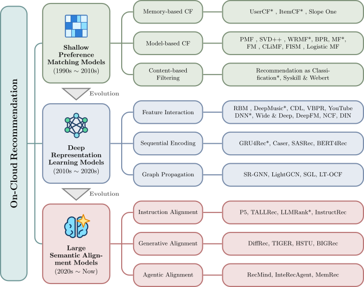
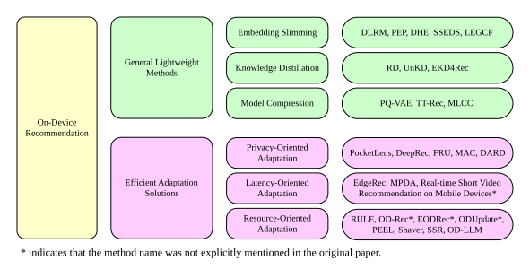
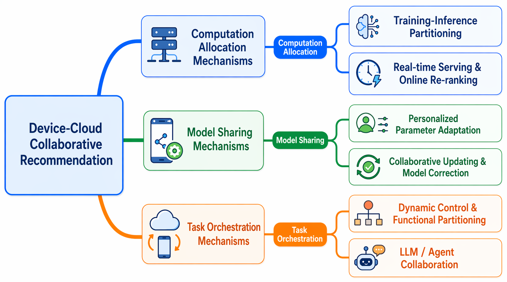
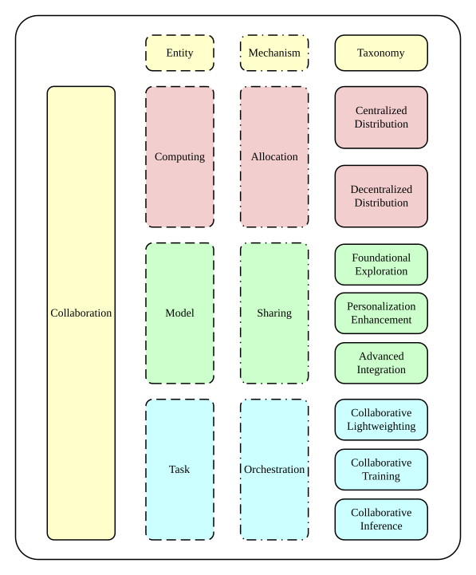

# Device-Cloud Personalization and Collaboration in Recommender Systems: A Systematic Survey in Large Model Era

**Abstract**: Recommender systems are undergoing a paradigm shift from on-cloud architectures to device-cloud collaborative intelligence in the large model era. Conventional on-cloud recommendation (OCRec) adopts a centralized learning paradigm, where user interaction data are uploaded to cloud servers for large-scale preference modeling, but suffers from high latency, privacy risks, and rising inference costs. In parallel, on-device recommendation (ODRec) deploys recommendation models on user devices for real-time preference modeling with local data, yet is limited by constrained computation and storage resources. These complementary characteristics have motivated device-cloud collaborative recommendation (DCRec), which integrates on-cloud contextual personalization with on-device real-time personalization through coordinated collaboration mechanisms. In this survey, we first review the architecture evolution of OCRec, from shallow preference matching and deep embedding models to large semantic alignment models, and summarize the efficient adaptation mechanisms of ODRec, including privacy-oriented, latency-oriented, and resource-oriented adaptation. We then present a novel collaboration-centric taxonomy of DCRec, covering computation allocation, model sharing, and task orchestration mechanisms. Finally, we summarize representative methods, evaluation settings, and open research directions, providing a structured foundation for next-generation recommender systems with improved adaptability, privacy, and efficiency.

## 📖Related Surveys

### Device-Cloud Collaboration for Artificial Intelligence

- Edge-Cloud Polarization and Collaboration: A Comprehensive Survey for AI, IEEE TKDE, 2023. [[PDF]](https://dl.acm.org/doi/abs/10.1109/TKDE.2022.3178211).
- End-Edge-Cloud Collaborative Computing for Deep Learning: A Comprehensive Survey, IEEE CST, 2024. [[PDF]](https://ieeexplore.ieee.org/abstract/document/10508191).
- Edge-Cloud Collaborative Computing on Distributed Intelligence and Model Optimization: A Survey, IEEE CST, 2026. [[PDF]](https://ieeexplore.ieee.org/abstract/document/11417814).
- Collaborative Learning of On-Device Small Model and Cloud-Based Large Model: Advances and Future Directions, Arxiv, 2025. [[PDF]](https://arxiv.org/abs/2504.15300).
- A Survey on Collaborative Mechanisms Between Large and Small Language Models, Arxiv, 2025. [[PDF]](https://arxiv.org/abs/2505.07460).

### Device-Cloud Personalization for Recommendation

- Distributed Recommendation Systems: Survey and Research Directions, ACM TOIS, 2024. [[PDF]](https://dl.acm.org/doi/epdf/10.1145/3694783).
- On-Device Recommender Systems: A Comprehensive Survey, DSE, 2025. [[PDF]](https://link.springer.com/article/10.1007/s41019-025-00308-8).
- A Survey on Federated Recommendation Systems, IEEE TNNLS, 2024. [[PDF]](https://ieeexplore.ieee.org/document/10423793).
- A Scenario-Oriented Survey of Federated Recommender Systems: Techniques, Challenges, and Future Directions, Arxiv, 2025. [[PDF]](https://arxiv.org/abs/2508.19620).
- Distributed Learning for Next-Gen Recommender Systems: A Survey, IPCID, 2025. [[PDF]](https://link.springer.com/chapter/10.1007/978-3-032-12481-4_7).
- Personalized Recommendation Models in Federated Settings: A Survey, IEEE TKDE, 2025. [[PDF]](https://ieeexplore.ieee.org/document/11151823).

## 🗄️On-Cloud Recommendation

### Shallow Preference Matching Models
>
> Shallow collaborative filtering models focus on **learning low-rank representations** of users and items from interaction data for preference prediction, mainly via:
> (1) ***Memory-based CF***: compute user/item similarities from historical co-interactions for neighborhood-based prediction; (2) ***Model-based CF***: factorize the interaction matrix into latent vectors with pointwise/pairwise optimization; (3) ***Content-based CF***: leverage item content or side information to build preference profiles.

#### Memory-based CF

- GroupLens: An Open Architecture for Collaborative Filtering of Netnews, ACM CSCW, 1994. [[PDF]](https://dl.acm.org/doi/10.1145/192844.192905), [[CODE]](https://github.com/hongleizhang/RSAlgorithms).
- Item-based Collaborative Filtering Recommendation Algorithms, WWW, 2001. [[PDF]](https://dl.acm.org/doi/10.1145/371920.372071), [[CODE]](https://github.com/hongleizhang/RSAlgorithms).
- FISM: Factored Item Similarity Models for Top-N Recommender Systems, KDD, 2013. [[PDF]](https://chbrown.github.io/kdd-2013-usb/kdd/p659.pdf), [[CODE]](https://github.com/hegongshan/factored_item_similarity_models).

#### Model-based CF

- Probabilistic Matrix Factorization, NIPS, 2007. [[PDF]](https://proceedings.neurips.cc/paper_files/paper/2007/file/d7322ed717dedf1eb4e6e52a37ea7bcd-Paper.pdf), [[CODE]](https://github.com/hongleizhang/RSAlgorithms).
- Factorization Meets the Neighborhood: A Multifaceted Collaborative Filtering Model, KDD, 2008. [[PDF]](https://people.engr.tamu.edu/huangrh/Spring16/papers_course/matrix_factorization.pdf), [[CODE]](https://github.com/hongleizhang/RSAlgorithms).
- Collaborative Filtering for Implicit Feedback Datasets, ICDM, 2008. [[PDF]](http://ieeexplore.ieee.org/document/4781121/), [[CODE]](https://github.com/benfred/implicit).
- Matrix Factorization Techniques for Recommender Systems, IEEE Computer, 2009. [[PDF]](https://ieeexplore.ieee.org/document/5197422), [[CODE]](https://github.com/hongleizhang/RSAlgorithms).
- BPR: Bayesian Personalized Ranking from Implicit Feedback, UAI, 2009. [[PDF]](https://arxiv.org/abs/1205.2618), [[CODE]](https://github.com/gamboviol/bpr).
- Factor in the neighbors: Scalable and accurate collaborative filtering, ACM TKDD, 2010. [[PDF]](https://dl.acm.org/doi/abs/10.1145/1644873.1644874), [[CODE]](https://github.com/hongleizhang/RSAlgorithms).
- Factorization Machines, ICDM, 2010. [[PDF]](https://analyticsconsultores.com.mx/wp-content/uploads/2019/03/Factorization-Machines-Steffen-Rendle-Osaka-University-2010.pdf), [[CODE]](https://github.com/coreylynch/pyFM).
- Recommender Systems with Social Regularization, WSDM, 2011. [[PDF]](https://dennyzhou.github.io/papers/RSR.pdf), [[CODE]](https://github.com/hongleizhang/RSAlgorithms).
- CLiMF: Learning to Maximize Reciprocal Rank with Collaborative Less-is-More Filtering, RecSys, 2012. [[PDF]](https://dl.acm.org/doi/10.1145/2365952.2365981), [[CODE]](https://github.com/gamboviol/climf).
- Logistic Matrix Factorization for Implicit Feedback Data, NIPS, 2014. [[PDF]](https://web.stanford.edu/~rezab/nips2014workshop/submits/logmat.pdf), [[CODE]](https://github.com/MrChrisJohnson/logistic-mf).

#### Content-based CF

- Syskill & Webert: Identifying interesting web sites, AAAI, 1996. [[PDF]](https://cdn.aaai.org/AAAI/1996/AAAI96-008.pdf).
- Recommendation as Classification: Using Social and Content-Based Information in Recommendation, AAAI, 1998. [[PDF]](https://cdn.aaai.org/AAAI/1998/AAAI98-101.pdf).

### Deep Representation Learning Models
>
> Deep representation learning models focus on **learning non-linear transformations** of user and item features through neural architectures for expressive representations, mainly via:
> (1) ***Feature Interaction***: design deep architectures to capture high-order feature crossings from multi-source inputs; (2) ***Sequential Modeling***: model temporal dependencies in user behavior sequences for next-item prediction; (3) ***Graph Modeling***: exploit high-order connectivity in user-item interaction graphs.

#### Feature Interaction

- Restricted Boltzmann Machines for Collaborative Filtering, ICML, 2007. [[PDF]](https://dl.acm.org/doi/10.1145/1273496.1273596).
- Deep Content-based Music Recommendation, NeurIPS, 2013. [[PDF]](https://papers.neurips.cc/paper/5004-deep-content-based-music-recommendation.pdf).
- Collaborative Deep Learning for Recommender Systems, KDD, 2015. [[PDF]](https://arxiv.org/pdf/1409.2944), [[CODE]](https://github.com/js05212/CDL).
- VBPR: Visual Bayesian Personalized Ranking from Implicit Feedback, AAAI, 2016. [[PDF]](https://dl.acm.org/doi/10.5555/3015812.3015834).
- Deep Neural Networks for YouTube Recommendations, RecSys, 2016. [[PDF]](https://dl.acm.org/doi/10.1145/2959100.2959190).
- Wide & Deep Learning for Recommender Systems, RecSys DLRS, 2016. [[PDF]](https://arxiv.org/abs/1606.07792).
- DeepFM: A Factorization-Machine based Neural Network for CTR Prediction, IJCAI, 2017. [[PDF]](https://arxiv.org/abs/1703.04247).
- Neural Collaborative Filtering, WWW, 2017. [[PDF]](https://arxiv.org/abs/1708.05031), [[CODE]](https://github.com/hexiangnan/neural_collaborative_filtering).
- Deep Interest Network for Click-Through Rate Prediction, KDD, 2018. [[PDF]](https://arxiv.org/abs/1706.06978), [[CODE]](https://github.com/zhougr1993/DeepInterestNetwork).

#### Sequential Encoding

- Self-Attentive Sequential Recommendation, ICDM, 2018. [[PDF]](https://ieeexplore.ieee.org/abstract/document/8594844), [[CODE]](https://github.com/kang205/SASRec).
- BERT4Rec: Sequential Recommendation with Bidirectional Encoder Representations from Transformer, CIKM, 2019. [[PDF]](https://arxiv.org/abs/1904.06690), [[CODE]](https://github.com/FeiSun/BERT4Rec).

#### Graph Propagation

- Session-Based Recommendation with Graph Neural Networks, AAAI, 2019. [[PDF]](https://ojs.aaai.org/index.php/AAAI/article/view/3804), [[CODE]](https://github.com/CRIPAC-DIG/SR-GNN).
- LightGCN: Simplifying and Powering Graph Convolution Network for Recommendation, SIGIR, 2020. [[PDF]](https://dl.acm.org/doi/10.1145/3397271.3401063), [[CODE]](https://github.com/gusye1234/LightGCN-PyTorch).
- Self-supervised Graph Learning for Recommendation, SIGIR, 2021. [[PDF]](https://wujcan.github.io/papers/sigir21-sgl.pdf), [[CODE]](https://github.com/wujcan/SGL-TensorFlow).
- LT-OCF: Learnable-Time ODE-based Collaborative Filtering, CIKM, 2021. [[PDF]](https://dl.acm.org/doi/10.1145/3459637.3482449), [[CODE]](https://github.com/jeongwhanchoi/LT-OCF).

### Large Semantic Alignment Models
>
> Large semantic alignment models focus on **bridging recommendation with semantic reasoning** through large-scale pre-trained models, mainly via:
> (1) ***Instruction Alignment***: reformulate recommendation as natural language generation tasks and fine-tune LLMs with recommendation-specific instructions; (2) ***Generative Alignment***: leverage generative paradigms (diffusion, autoregressive tokenization) for item generation or retrieval; (3) ***Agentic Alignment***: employ LLMs as autonomous agents for multi-step reasoning, tool use, and interactive recommendation.

#### Instruction Alignment

- Recommendation as Language Processing: A Unified Pretrain, Personalized Prompt & Predict Paradigm, RecSys, 2022. [[PDF]](https://dl.acm.org/doi/10.1145/3523227.3546767), [[CODE]](https://github.com/jeykigung/P5).
- TALLRec: An Effective and Efficient Tuning Framework to Align Large Language Model with Recommendation, RecSys, 2023. [[PDF]](http://arxiv.org/abs/2305.00447), [[CODE]](https://github.com/SAI990323/TALLRec).
- Large Language Models are Zero-Shot Rankers for Recommender Systems, ECIR, 2024. [[PDF]](https://arxiv.org/abs/2305.08845), [[CODE]](https://github.com/RUCAIBox/LLMRank).
- A Bi-Step Grounding Paradigm for Large Language Models in Recommendation Systems, ACM TORS, 2025. [[PDF]](https://dl.acm.org/doi/full/10.1145/3716393), [[CODE]](https://github.com/SAI990323/BIGRec).

#### Generative Alignment

- Diffusion Recommender Model, SIGIR, 2023. [[PDF]](https://dl.acm.org/doi/10.1145/3539618.3591663), [[CODE]](https://github.com/YiyanXu/DiffRec).
- Recommender Systems with Generative Retrieval, NeurIPS, 2023. [[PDF]](http://arxiv.org/abs/2305.05065).
- Actions Speak Louder than Words: Trillion-Parameter Sequential Transducers for Generative Recommendations, ICML, 2024. [[PDF]](https://arxiv.org/pdf/2402.17152), [[CODE]](https://github.com/meta-recsys/generative-recommenders).

#### Agentic Alignment

- RecMind: Large Language Model Powered Agent For Recommendation, NAACL Findings, 2024. [[PDF]](https://aclanthology.org/2024.findings-naacl.271.pdf).
- Recommender AI Agent: Integrating Large Language Models for Interactive Recommendations, ACM TOIS, 2025. [[PDF]](https://dl.acm.org/doi/10.1145/3731446), [[CODE]](https://github.com/microsoft/RecAI/tree/main/InteRecAgent).
- MemRec: Collaborative Memory-Augmented Agentic Recommender System, ACL, 2026. [[PDF]](https://arxiv.org/abs/2601.08816), [[CODE]](https://github.com/rutgerswiselab/memrec).

## 📱On-Device Recommendation

### General Lightweight Methods
>
> General lightweight methods focus on **static model slimming for deployable on-device inference**, where the dominant bottleneck is often the embedding table, mainly via:
(1) ***Embedding Slimming***: allocate embedding capacity non-uniformly (search/prune mixed dimensions) or replace tables with lightweight embedding generators to fit constraints; (2) ***Knowledge Distillation***: transfer ranking/sequential knowledge from large (often cloud) teachers to compact on-device students with minimal quality loss; (3) ***Model Compression***: quantize/factorize mechanisms (e.g., PQ, complementary partitions, tensor trains) to shrink storage and accelerate lookups.

#### Embedding Slimming

- Compositional Embeddings Using Complementary Partitions for Memory-Efficient Recommendation Systems, KDD, 2020. [[PDF]](https://arxiv.org/abs/1909.02107).
- Learnable Embedding Sizes for Recommender Systems, ICLR, 2021. [[PDF]](https://arxiv.org/abs/2101.07577), [[CODE]](https://github.com/ssui-liu/learnable-embed-sizes-for-RecSys).
- Learning to Embed Categorical Features without Embedding Tables for Recommendation, KDD, 2021. [[PDF]](https://arxiv.org/abs/2010.10784).
- Single-shot Embedding Dimension Search in Recommender System, SIGIR, 2022. [[PDF]](https://dl.acm.org/doi/epdf/10.1145/3477495.3532060).
- Lightweight Embeddings for Graph Collaborative Filtering, SIGIR, 2024. [[PDF]](https://arxiv.org/abs/2403.18479), [[CODE]](https://github.com/xurong-liang/LEGCF).

#### Structure Compression

- PQ-VAE: Efficient Recommendation Using Quantized Embeddings, RecSys, 2019. [[PDF]](https://ceur-ws.org/Vol-2431/paper10.pdf).
- TT-Rec: Tensor Train Compression for Deep Learning Recommendation Models, MLSys, 2021. [[PDF]](https://arxiv.org/abs/2101.11714), [[CODE]](https://github.com/facebookresearch/FBTT-Embedding).
- Compress, Cross and Scale: Multi-Level Compression Cross Networks for Efficient Scaling in Recommender Systems, 2026. [[PDF]](https://arxiv.org/pdf/2602.12041), [[CODE]](https://github.com/shishishu/MLCC).

#### Knowledge Distillation

- Ranking Distillation: Learning Compact Ranking Models with High Performance for Recommender System, KDD, 2018. [[PDF]](https://arxiv.org/abs/1809.07428).
- Unbiased Knowledge Distillation for Recommendation, WSDM, 2023. [[PDF]](https://arxiv.org/abs/2211.14729), [[CODE]](https://github.com/chengang95/UnKD).
- EKD4Rec: Ensemble Knowledge Distillation from LLM-based Models to Traditional Sequential Recommenders, WWW, 2025. [[PDF]](https://dl.acm.org/doi/10.1145/3701716.3715527).

### Efficient Adaptation Solutions
>
> Efficient adaptation solutions focus on **personalized adaptation** (updating after deployment) while respecting real-world constraints, typically along:
(1) ***Privacy-Oriented Adaptation***: keep data local and adapt via federated/decentralized learning (and unlearning) without exposing raw user data; (2) ***Latency-Oriented Adaptation***: design fast inference and update pipelines that react to short-term drift under strict serving budgets; (3) ***Resource-Oriented Adaptation***: tailor model size, update scope/frequency, and communication to device compute/memory/energy and network limits.

#### Privacy-Oriented Adaptation

- PocketLens: Toward a Personal Recommender System, ACM TOIS, 2004. [[PDF]](https://dl.acm.org/doi/10.1145/1010614.1010618).
- DeepRec: On-Device Deep Learning for Privacy-preserving Sequential Recommendation in Mobile Commerce, WWW, 2021. [[PDF]](https://dl.acm.org/doi/abs/10.1145/3442381.3449942), [[CODE]](https://github.com/hanjialiang/DeepRec).
- Federated Unlearning for On-Device Recommendation, WSDM, 2023. [[PDF]](https://arxiv.org/abs/2210.10958).
- Model-Agnostic Decentralized Collaborative Learning for On-Device POI Recommendation, SIGIR, 2023. [[PDF]](https://arxiv.org/abs/2304.03947).
- Decentralized Collaborative Learning with Adaptive Reference Data for On-Device POI Recommendation, WWW, 2024. [[PDF]](https://arxiv.org/abs/2401.13448).

#### Latency-Oriented Adaptation

- EdgeRec: Recommender System on Edge in Mobile Taobao, CIKM, 2020. [[PDF]](https://arxiv.org/abs/2005.08416).
- On-Device Learning for Model Personalization with Large-Scale Cloud-Coordinated Domain Adaption, KDD, 2022. [[PDF]](https://doi.org/10.1145/3534678.3539263), [[CODE]](https://github.com/mikudehuane/MPDA).
- Real-time Short Video Recommendation on Mobile Devices, CIKM, 2022. [[PDF]](https://dl.acm.org/doi/10.1145/3511808.3557065).

#### Resource-Oriented Adaptation

- Learning Elastic Embeddings for Customizing On-Device Recommenders, KDD, 2021. [[PDF]](https://arxiv.org/abs/2106.02223).
- On-Device Next-item Recommendation with Self-supervised Knowledge Distillation, SIGIR, 2022. [[PDF]](https://dl.acm.org/doi/pdf/10.1145/3477495.3531775), [[CODE]](https://github.com/xiaxin1998/OD-Rec).
- Efficient On-Device Session-based Recommendation, ACM TOIS, 2023. [[PDF]](https://dl.acm.org/doi/pdf/10.1145/3580364), [[CODE]](https://github.com/xiaxin1998/EODRec).
- Towards Communication-Efficient Model Updating for On-Device Session-Based Recommendation, CIKM, 2023. [[PDF]](https://arxiv.org/abs/2308.12777), [[CODE]](https://github.com/xiaxin1998/ODUpdate).
- Personalized Elastic Embedding Learning for On-Device Recommendation, IEEE TKDE, 2024. [[PDF]](https://arxiv.org/pdf/2306.10532).
- On-Device Content-based Recommendation with Single-shot Embedding Pruning: A Cooperative Game Perspective, WWW, 2025. [[PDF]](https://dl.acm.org/doi/abs/10.1145/3696410.3714921), [[CODE]](https://github.com/chenxing1999/shaver).
- Cost-Effective On-Device Sequential Recommendation with Spiking Neural Networks, IJCAI, 2025. [[PDF]](https://www.ijcai.org/proceedings/2025/0398.pdf).
- On-Device Large Language Models for Sequential Recommendation, WSDM, 2026. [[PDF]](https://dl.acm.org/doi/abs/10.1145/3773966.3777961).

## 🔄Device-Cloud Collaborative Recommendation

<!--  -->

### Computation Allocation Mechanisms
>
> Computation allocation is primarily enabled by **Distributed Recommendation**:
(1) ***Coordinated Parallelism***: distribute computation under an explicit central coordinator; (2) ***Decentralized Partitioning***: diffuse knowledge through peer-to-peer interactions without any authoritative center.

#### Coordinated Parallelism

- TiVo: Making Show Recommendations Using A Distributed Collaborative Filtering Architecture, KDD, 2004. [[PDF]](https://dl.acm.org/doi/abs/10.1145/1014052.1014097).
- Distributed Rating Prediction in User Generated Content Streams, RecSys, 2011. [[PDF]](https://dl.acm.org/doi/abs/10.1145/2043932.2043948).
- Distributed Collaborative Filtering with Singular Ratings for Large-Scale Recommendation, Journal of Systems and Software, 2014. [[PDF]](https://www.sciencedirect.com/science/article/abs/pii/S0164121214001150).
- FDML: A Collaborative Machine Learning Framework for Distributed Features, KDD, 2019. [[PDF]](https://dl.acm.org/doi/abs/10.1145/3292500.3330765).
- EdgeRec: Recommender System on Edge in Mobile Taobao, CIKM, 2020. [[PDF]](https://arxiv.org/abs/2005.08416).
- Distributed Equivalent Substitution Training for Large-Scale Recommender Systems, SIGIR, 2020. [[PDF]](https://dl.acm.org/doi/abs/10.1145/3397271.3401113).
- Distributed Hierarchical GPU Parameter Server for MassiveScale Deep Learning Ads Systems, MLSys, 2020. [[PDF]](https://proceedings.mlsys.org/paper_files/paper/2020/hash/6e426f4c16c6677a605375ae2e4877d5-Abstract.html).
- Fast Distributed Bandits for Online Recommendation Systems, ICS, 2020. [[PDF]](https://dl.acm.org/doi/abs/10.1145/3392717.3392748).
- On Scalability of Association-rule-based Recommendation: A Unified Distributed-computing Framework, ACM TWEB, 2020. [[PDF]](https://dl.acm.org/doi/abs/10.1145/3398202).
- MC2-SF: Slow-Fast Learning for Mobile-Cloud Collaborative Recommendation, Arxiv, 2021. [[PDF]](https://arxiv.org/abs/2109.12314).
- Training Recommender Systems at Scale: Communication-Efficient Model and Data Parallelism, KDD, 2021. [[PDF]](https://dl.acm.org/doi/abs/10.1145/3447548.3467080).
- Distributed Recommendation Inference on FPGA Clusters, FPL, 2021. [[PDF]](https://ieeexplore.ieee.org/abstract/document/9556456).
- Ekko: A Large-Scale Deep Learning Recommender System with Low-Latency Model Update, OSDI, 2022. [[PDF]](https://www.usenix.org/conference/osdi22/presentation/sima).
- OpenEmbedding: A Distributed Parameter Server for Deep Learning Recommendation Models using Persistent Memory, ICDE, 2023. [[PDF]](https://ieeexplore.ieee.org/abstract/document/10184695), [[CODE]](https://github.com/4paradigm/OpenEmbedding).
- Edge-cloud Collaborative Learning with Federated and Centralized Features, SIGIR, 2023. [[PDF]](https://dl.acm.org/doi/abs/10.1145/3539618.3591976).
- A Federated Collaborative Recommendation Model for Privacy-Preserving Distributed Recommender Applications Based on Microservice Framework, Journal of Parallel and Distributed Computing, 2023. [[PDF]](https://www.sciencedirect.com/science/article/abs/pii/S0743731522002477).
- Deep-Distributed-Learning-Based POI Recommendation Under Mobile-Edge Networks, IEEE IOT, 2023. [[PDF]](https://ieeexplore.ieee.org/abstract/document/9869716).
- Accelerating Neural Recommendation Training with Embedding Scheduling, NSDI, 2024. [[PDF]](https://www.usenix.org/conference/nsdi24/presentation/zeng), [[CODE]](https://github.com/HKUST-SING/herald).
- FairSync: Ensuring Amortized Group Exposure in Distributed Recommendation Retrieval, WWW, 2024. [[PDF]](https://dl.acm.org/doi/abs/10.1145/3589334.3645413).
- Faster Distributed Inference-Only Recommender Systems via Bounded Lag Synchronous Collectives, Arxiv, 2025. [[PDF]](https://arxiv.org/abs/2512.19342).
- NestPipe: Large-Scale Recommendation Training on 1,500+ Accelerators via Nested Pipelining, ArXiv, 2026. [[PDF]](https://arxiv.org/abs/2604.06956).

#### Decentralized Partitioning

- Decentralized Recommender Systems, Arxiv, 2015. [[PDF]](https://arxiv.org/abs/1503.01647).
- Privacy Preserving Point-of-Interest Recommendation using Decentralized Matrix Factorization, AAAI, 2018. [[PDF]](https://ojs.aaai.org/index.php/AAAI/article/view/11244).
- PDMFRec: A Decentralised Matrix Factorisation with Tunable User-Centric Privacy, RecSys, 2019. [[PDF]](https://dl.acm.org/doi/abs/10.1145/3298689.3347035).
- Decentralized Construction of Knowledge Graphs for Deep Recommender Systems Based on Blockchain-Powered Smart Contracts, IEEE Access, 2019. [[PDF]](https://ieeexplore.ieee.org/abstract/document/8844724).
- Decentralized Recommendation Based on Matrix Factorization: A Comparison of Gossip and Federated Learning, ECML-PKDD, 2019. [[PDF]](https://link.springer.com/chapter/10.1007/978-3-030-43823-4_27).
- PEPPER: Empowering User-Centric Recommender Systems over Gossip Learning, IMWUT, 2022. [[PDF]](https://dl.acm.org/doi/abs/10.1145/3550302).
- Decentralized Collaborative Learning Framework for Next POI Recommendation, ACM TOIS, 2023. [[PDF]](https://dl.acm.org/doi/full/10.1145/3555374).
- GDSRec: Graph-Based Decentralized Collaborative Filtering for Social Recommendation, IEEE TKDE, 2023. [[PDF]](https://ieeexplore.ieee.org/abstract/document/9721542), [[CODE]](https://github.com/MEICRS/GDSRec).
- Decentralized Graph Neural Network for Privacy-Preserving Recommendation, CIKM, 2023. [[PDF]](https://dl.acm.org/doi/abs/10.1145/3583780.3614834).
- Decentralized Federated Recommendation with Privacy-aware Structured Client-level Graph, ACM TIST, 2024. [[PDF]](https://dl.acm.org/doi/full/10.1145/3641287).
- DecKG: Decentralized Collaborative Learning with Knowledge Graph Enhancement for POI Recommendation, Information Sciences, 2025. [[PDF]](https://www.sciencedirect.com/science/article/abs/pii/S0020025525007030).
- Decentralized Next Point-of-Interest Recommendation Guided by Willingness to Share, ACM TOIS, 2025. [[PDF]](https://dl.acm.org/doi/full/10.1145/3766066).
- D-RecSys: A Decentralized Recommendation Framework for Web 3.0-Based Content-Sharing Platforms, ACM TOIT, 2025. [[PDF]](https://dl.acm.org/doi/full/10.1145/3771093).

### Model Sharing Mechanisms
>
> Model sharing is primarily enabled by **Federated Recommendation**:
(1) ***Foundational Fusion***: basic model and scenarios, privacy and efficiency optimization; (2) ***Personalized Aggregation***: global aggregation and local adaptation; (3) ***Advanced Integration***: cross-domain, multi-modal and foundation models.

#### Foundational Fusion

- Federated Collaborative Filtering for Privacy-Preserving Personalized Recommendation System, Arxiv, 2019. [[PDF]](https://arxiv.org/abs/1901.09888).
- Federated Recommendation System via Differential Privacy, IEEE ISIT, 2020. [[PDF]](https://ieeexplore.ieee.org/abstract/document/9174297).
- Meta Matrix Factorization for Federated Rating Predictions, SIGIR, 2020. [[PDF]](https://dl.acm.org/doi/abs/10.1145/3397271.3401081), [[CODE]](https://github.com/TempSDU/MetaMF).
- Secure Federated Matrix Factorization, IEEE IS, 2020. [[PDF]](https://ieeexplore.ieee.org/abstract/document/9162459), [[CODE]](https://github.com/Di-Chai/FedMF).
- FedRec: Federated Recommendation With Explicit Feedback, IEEE IS, 2020. [[PDF]](https://ieeexplore.ieee.org/abstract/document/9170754).
- FedFast: Going Beyond Average for Faster Training of Federated Recommender Systems, KDD, 2020. [[PDF]](https://dl.acm.org/doi/abs/10.1145/3394486.3403176).
- FedGNN: Federated Graph Neural Network for Privacy-Preserving Recommendation, ICML Workshop, 2021. [[PDF]](https://arxiv.org/abs/2102.04925).
- FedRec++: Lossless Federated Recommendation with Explicit Feedback, AAAI, 2021. [[PDF]](https://ojs.aaai.org/index.php/AAAI/article/view/16546).
- Horizontal Cross-Silo Federated Recommender Systems, RecSys, 2021. [[PDF]](https://dl.acm.org/doi/abs/10.1145/3460231.3478863).
- FR-FMSS: Federated Recommendation via Fake Marks and Secret Sharing, RecSys, 2021. [[PDF]](https://dl.acm.org/doi/10.1145/3460231.3478855).
- FedCT: Federated Collaborative Transfer for Recommendation, SIGIR, 2021. [[PDF]](https://dl.acm.org/doi/abs/10.1145/3404835.3462825).
- Federated Neural Collaborative Filtering, KBS, 2022. [[PDF]](https://www.sciencedirect.com/science/article/abs/pii/S0950705122001812).
- A Federated Graph Neural Network Framework for Privacy-preserving Personalization, Nature Communications, 2022. [[PDF]](https://www.nature.com/articles/s41467-022-30714-9), [[CODE]](https://github.com/wuch15/FedPerGNN).
- PipAttack: Poisoning Federated Recommender Systems for Manipulating Item Promotion, WSDM, 2022. [[PDF]](https://dl.acm.org/doi/abs/10.1145/3488560.3498386).
- Poisoning Deep Learning based Recommender Model in Federated Learning Scenarios, IJCAI, 2022. [[PDF]](https://www.ijcai.org/proceedings/2022/306), [[CODE]](https://github.com/rdz98/PoisonFedDLRS).
- LightFR: Lightweight Federated Recommendation with Privacy-preserving Matrix Factorization, ACM TOIS, 2023. [[PDF]](https://dl.acm.org/doi/full/10.1145/3578361), [[CODE]](https://github.com/hongleizhang/LightFR).
- Semi-decentralized Federated Ego Graph Learning for Recommendation, WWW, 2023. [[PDF]](https://dl.acm.org/doi/abs/10.1145/3543507.3583337).
- Fine-Grained Preference-Aware Personalized Federated POI Recommendation with Data Sparsity, SIGIR, 2023. [[PDF]](https://dl.acm.org/doi/abs/10.1145/3539618.3591688), [[CODE]](https://github.com/Leavesy/PrefFedPOI).
- PrivateRec: Differentially Private Model Training and Online Serving for Federated News Recommendation, KDD, 2023. [[PDF]](https://dl.acm.org/doi/abs/10.1145/3580305.3599889).
- PrivFR: Privacy-Enhanced Federated Recommendation With Shared Hash Embedding, IEEE TNNLS, 2024. [[PDF]](https://ieeexplore.ieee.org/abstract/document/10506199).
- Towards Efficient Communication and Secure Federated Recommendation System via Low-rank Training, WWW, 2024. [[PDF]](https://dl.acm.org/doi/abs/10.1145/3589334.3645702), [[CODE]](https://github.com/NNHieu/CoLR-FedRec).
- Hide Your Model: A Parameter Transmission-free Federated Recommender System, ICDE, 2024. [[PDF]](https://ieeexplore.ieee.org/abstract/document/10597708).
- Not One Less: Exploring Interplay between User Profiles and Items in Untargeted Attacks against Federated Recommendation, CCS, 2024. [[PDF]](https://dl.acm.org/doi/abs/10.1145/3658644.3670365).
- Rethinking Byzantine Robustness in Federated Recommendation from Sparse Aggregation Perspective, AAAI, 2025. [[PDF]](https://ojs.aaai.org/index.php/AAAI/article/view/33455).
- Spattack: Subgroup Poisoning Attacks on Federated Recommender Systems, WWW, 2026. [[PDF]](https://dl.acm.org/doi/10.1145/3774904.3792552).
- FedAU2: Attribute Unlearning for User-Level Federated Recommender Systems with Adaptive and Robust Adversarial Training, AAAI, 2026. [[PDF]](https://ojs.aaai.org/index.php/AAAI/article/view/39500).
- From Transfer to Collaboration: A Federated Framework for Cross-Market Sequential Recommendation, Arxiv, 2026. [[PDF]](https://arxiv.org/abs/2604.13573).

#### Personalized Aggregation

- Hierarchical Personalized Federated Learning for User Modeling, WWW, 2021. [[PDF]](https://dl.acm.org/doi/abs/10.1145/3442381.3449926), [[CODE]](https://github.com/bigdata-ustc/hierarchical-personalized-federated-learning).
- ReFRS: Resource-efficient Federated Recommender System for Dynamic and Diversified User Preferences, ACM TOIS, 2023. [[PDF]](https://dl.acm.org/doi/full/10.1145/3560486).
- Dual Personalization on Federated Recommendation, IJCAI, 2023. [[PDF]](https://www.ijcai.org/proceedings/2023/0507), [[CODE]](https://github.com/Zhangcx19/IJCAI-23-PFedRec).
- Federated Recommendation with Additive Personalization, ICLR, 2024. [[PDF]](https://iclr.cc/virtual/2024/poster/17446), [[CODE]](https://github.com/mtics/FedRAP).
- GPFedRec: Graph-Guided Personalization for Federated Recommendation, KDD, 2024. [[PDF]](https://dl.acm.org/doi/abs/10.1145/3637528.3671702), [[CODE]](https://github.com/Zhangcx19/GPFedRec).
- Co-clustering for Federated Recommender System, WWW, 2024. [[PDF]](https://dl.acm.org/doi/abs/10.1145/3589334.3645626), [[CODE]](https://github.com/Xinrui17/CoFedRec).
- When Federated Recommendation Meets Cold-Start Problem: Separating Item Attributes and User Interactions, WWW, 2024. [[PDF]](https://dl.acm.org/doi/abs/10.1145/3589334.3645525), [[CODE]](https://github.com/Zhangcx19/IFedRec).
- Towards Personalized Privacy: User-Governed Data Contribution for Federated Recommendation, WWW, 2024. [[PDF]](https://dl.acm.org/doi/abs/10.1145/3589334.3645690).
- HeteFedRec: Federated Recommender Systems with Model Heterogeneity, ICDE, 2024. [[PDF]](https://ieeexplore.ieee.org/abstract/document/10598074).
- Personalized Federated Collaborative Filtering: A Variational AutoEncoder Approach, AAAI, 2025. [[PDF]](https://ojs.aaai.org/index.php/AAAI/article/view/34047), [[CODE]](https://github.com/mtics/FedDAE).
- Federated Recommendation with Explicitly Encoding Item Bias, AAAI, 2025. [[PDF]](https://ojs.aaai.org/index.php/AAAI/article/view/33395).
- Personalized Federated Recommendation for Cold-Start Users via Adaptive Knowledge Fusion, WWW, 2025. [[PDF]](https://dl.acm.org/doi/abs/10.1145/3696410.3714635).
- Beyond Personalization: Federated Recommendation with Calibration via Low-rank Decomposition, Arxiv, 2025. [[PDF]](https://arxiv.org/abs/2506.09525), [[CODE]](https://github.com/jundongchen13/PFedCLR).
- Joint Item Embedding Dual-view Exploration and Adaptive Local-Global Fusion for Federated Recommendation, SIGIR, 2025. [[PDF]](https://dl.acm.org/doi/abs/10.1145/3726302.3730016).
- Personalized Federated Recommendation with Multi-Faceted User Representation and Global Consistent Prototype, CIKM, 2025. [[PDF]](https://dl.acm.org/doi/abs/10.1145/3746252.3761213).
- FedCIA: Federated Collaborative Information Aggregation for Privacy-Preserving Recommendation, SIGIR, 2025. [[PDF]](https://dl.acm.org/doi/abs/10.1145/3726302.3729977), [[CODE]](https://github.com/Mingzhe-Han/FedCIA).
- Efficient Knowledge Transfer in Federated Recommendation for Joint Venture Ecosystem, NeurIPS, 2025. [[PDF]](https://neurips.cc/virtual/2025/loc/mexico-city/poster/117351).
- Federated Continual Recommendation, CIKM, 2025. [[PDF]](https://dl.acm.org/doi/abs/10.1145/3746252.3761268), [[CODE]](https://github.com/Jaehyung-Lim/F3CRec-CIKM-25).
- Beyond Similarity: Personalized Federated Recommendation with Composite Aggregation, ACM TOIS, 2026. [[PDF]](https://dl.acm.org/doi/full/10.1145/3779442), [[CODE]](https://github.com/hongleizhang/FedCA).
- Federated Recommendation via Stochastic Aggregation and Consistency Inference, ACM TOIS, 2026. [[PDF]](https://dl.acm.org/doi/full/10.1145/3795526),[[CODE]](https://www.sdu-idea.cn/codes.php?name=FedSC).
- Sharpness-Aware Minimization for Generalized Embedding Learning in Federated Recommendation, WWW, 2026. [[PDF]](https://dl.acm.org/doi/10.1145/3774904.3792579), [[CODE]](https://github.com/anonymifish/FedRecGEL).
- Low-pass Personalized Subgraph Federated Recommendation, ICLR, 2026. [[PDF]](https://openreview.net/pdf?id=SSd3GENRAU), [[CODE]](https://github.com/dntjr41/LPSFed).
- Breaking the Aggregation Bottleneck in Federated Recommendation: A Personalized Model Merging Approach, AAAI, 2026. [[PDF]](https://ojs.aaai.org/index.php/AAAI/article/view/38472), [[CODE]](https://github.com/jundongchen13/FedEM).

#### Advanced Integration

- FedCDR: Federated Cross-Domain Recommendation for Privacy-Preserving Rating Prediction, CIKM, 2022. [[PDF]](https://dl.acm.org/doi/abs/10.1145/3511808.3557320).
- Win-Win: A Privacy-Preserving Federated Framework for Dual-Target Cross-Domain Recommendation, AAAI, 2023. [[PDF]](https://ojs.aaai.org/index.php/AAAI/article/view/25531).
- Manipulating Visually-aware Federated Recommender Systems and Its Countermeasures, ACM TOIS, 2023. [[PDF]](https://dl.acm.org/doi/full/10.1145/3630005).
- Federated Adaptation for Foundation Model-based Recommendations, IJCAI, 2024. [[PDF]](https://www.ijcai.org/proceedings/2024/603), [[CODE]](https://github.com/Zhangcx19/IJCAI-24-FedPA).
- Prompt-enhanced Federated Content Representation Learning for Cross-domain Recommendation, WWW, 2024. [[PDF]](https://dl.acm.org/doi/abs/10.1145/3589334.3645337), [[CODE]](https://github.com/Ckano/PFCR).
- Multifaceted User Modeling in Recommendation: A Federated Foundation Models Approach, AAAI, 2025. [[PDF]](https://ojs.aaai.org/index.php/AAAI/article/view/33440), [[CODE]](https://github.com/Zhangcx19/AAAI-25-MRFF).
- Federated Semantic Learning for Privacy-preserving Cross-domain Recommendation, ACM TOIS, 2025. [[PDF]](https://dl.acm.org/doi/full/10.1145/3728359), [[CODE]](https://github.com/Sapphire-star/FFMSR).
- FELLAS: Enhancing Federated Sequential Recommendation with LLM as External Services, ACM TOIS, 2025. [[PDF]](https://dl.acm.org/doi/10.1145/3709138).
- Federated Vision-Language-Recommendation with Personalized Fusion, AAAI, 2026. [[PDF]](https://ojs.aaai.org/index.php/AAAI/article/view/39503), [[CODE]](https://github.com/mtics/FedVLR).
- Multimodal-enhanced Federated Recommendation: A Group-wise Fusion Approach, WWW, 2026. [[PDF]](https://dl.acm.org/doi/10.1145/3774904.3792573), [[CODE]](https://github.com/Zhangwp2420/GFMFR).
- TransFR: Transferable Federated Recommendation with Adapter Tuning on Pre-trained Language Models, AAAI, 2026. [[PDF]](https://ojs.aaai.org/index.php/AAAI/article/view/40048), [[CODE]](https://github.com/hongleizhang/TransFR).

### Task Orchestration Mechanisms
>
> Task orchestration is primarily enabled by **Device-Cloud Recommendation**:
(1) ***Module Scheduling***: cloud constructs customized device modules offline for independent on-device inference; (2) ***Knowledge Routing***: cloud provides continuous supervisory signals during device model deployment; (3) ***Inference Dispatching***: cloud and device jointly decompose complementary sub-tasks at inference time.

#### Module Scheduling

- Device-Cloud Collaborative Learning for Recommendation, KDD, 2021. [[PDF]](https://dl.acm.org/doi/abs/10.1145/3447548.3467097).
- DUET: A Tuning-Free Device-Cloud Collaborative Parameters Generation Framework for Efficient Device Model Generalization, WWW, 2023. [[PDF]](https://dl.acm.org/doi/abs/10.1145/3543507.3583451), [[CODE]](https://github.com/HelloZicky/DUET).
- DeCoCDR: Deployable Cloud-Device Collaboration for Cross-Domain Recommendation, SIGIR, 2024. [[PDF]](https://dl.acm.org/doi/abs/10.1145/3626772.3657786).
- DIET: Customized Slimming for Incompatible Networks in Sequential Recommendation, KDD, 2024. [[PDF]](https://dl.acm.org/doi/abs/10.1145/3637528.3671669).
- DualRec: A Collaborative Training Framework for Device and Cloud Recommendation Models, IEEE TMC, 2025. [[PDF]](https://ieeexplore.ieee.org/abstract/document/10840283/).
- Forward Once for All: Structural Parameterized Adaptation for Efficient Cloud-coordinated On-Device Recommendation, KDD, 2025. [[PDF]](https://dl.acm.org/doi/abs/10.1145/3690624.3709178).
- CHORD: Customizing Hybrid-precision On-Device Model for Sequential Recommendation with Device-Cloud Collaboration, MM, 2025. [[PDF]](https://dl.acm.org/doi/abs/10.1145/3746027.3755632).

#### Knowledge Routing

- Device-Cloud Collaborative Recommendation via Meta Controller, KDD, 2022. [[PDF]](https://dl.acm.org/doi/abs/10.1145/3534678.3539181).
- On-Device Learning for Model Personalization with Large-Scale Cloud-Coordinated Domain Adaption, KDD, 2022. [[PDF]](https://dl.acm.org/doi/abs/10.1145/3534678.3539263), [[CODE]](https://github.com/mikudehuane/MPDA).
- CoRec: An Efficient Internet Behavior-based Recommendation Framework with Edge-cloud Collaboration on Deep Convolution Neural Networks, ACM TOSN, 2022. [[PDF]](https://dl.acm.org/doi/full/10.1145/3526191).
- RelayRec: Empowering Privacy-Preserving CTR Prediction via Cloud-Device Relay Learning, IPSN, 2024. [[PDF]](https://ieeexplore.ieee.org/abstract/document/10577321).
- Intelligent Model Update Strategy for Sequential Recommendation, WWW, 2024. [[PDF]](https://dl.acm.org/doi/abs/10.1145/3589334.3645316), [[CODE]](https://github.com/HelloZicky/IntellectReq).
- Backpropagation-Free Multi-modal On-Device Model Adaptation via Cloud-Device Collaboration, ACM TOMM, 2025. [[PDF]](https://dl.acm.org/doi/full/10.1145/3706422).
- Device-Cloud Collaborative Correction for On-Device Recommendation, IJCAI, 2025. [[PDF]](https://arxiv.org/abs/2506.12687), [[CODE]](https://github.com/Yuzt-zju/CoCorrRec).
- SCaLRec: Semantic Calibration for LLM-enabled Cloud-Device Sequential Recommendation, Arxiv, 2026. [[PDF]](https://arxiv.org/abs/2601.22543).

#### Inference Dispatching

- Real-time Short Video Recommendation on Mobile Devices, CIKM, 2022. [[PDF]](https://dl.acm.org/doi/abs/10.1145/3511808.3557065).
- On-Device Integrated Re-ranking with Heterogeneous Behavior Modeling, KDD, 2023. [[PDF]](https://dl.acm.org/doi/abs/10.1145/3580305.3599878).
- Diffusion-Based Cloud-Edge-Device Collaborative Learning for Next POI Recommendations, KDD, 2024. [[PDF]](https://dl.acm.org/doi/abs/10.1145/3637528.3671743).
- Collaboration of Large Language Models and Small Recommendation Models for Device-Cloud Recommendation, KDD, 2025. [[PDF]](https://dl.acm.org/doi/abs/10.1145/3690624.3709335), [[CODE]](https://github.com/HelloZicky/LSC4Rec).
- Cloud-Device Collaborative Agents for Sequential Recommendation, Arxiv, 2025. [[PDF]](https://arxiv.org/abs/2509.01551).
